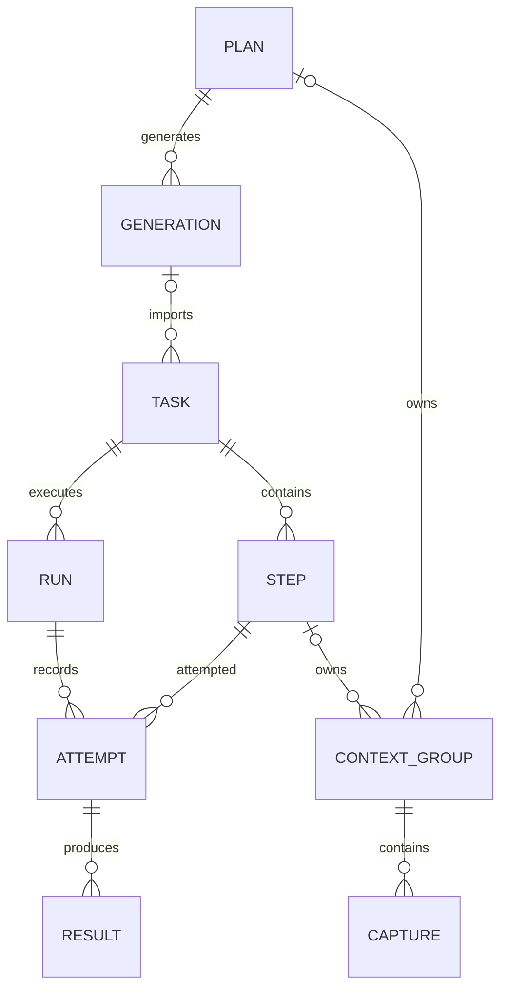

# 领域模型

TaskWeave是本地任务与步骤自动化工作台。用户准备任务定义、输入与环境，经手写或AI辅助编写步骤，验证后运行固定内容，并查看持久化结果。模型参与编写，执行器执行已经定义的内容。

## 主要对象

| 对象 | 含义 | 关系与边界 |
| --- | --- | --- |
| 任务 Task | 可重复执行的有序步骤定义 | 拥有任务输入Schema、说明和步骤；不同运行共享定义来源，运行数据各自独立 |
| 任务组合 TaskSequence | 按顺序引用已有任务的可保存定义 | 每个节点有独立ID；可重复引用同一任务，并将前序步骤JSON输出映射到后续输入 |
| 组合运行 SequenceRun | 一次完整组合执行及节点进度 | 冻结顺序、映射和版本指纹；每个节点拥有一个普通正式运行 |
| 步骤 Step | 一段异步Python内容及其执行契约 | 归属任务；声明输入/输出Schema、绑定、能力、插件要求和时间限制 |
| 规划 Plan | 将目标、插件能力与采集材料组织成候选任务的工作区 | 有revision；生成记录冻结请求材料；导入后形成独立任务 |
| 生成记录 Generation | 一次规划生成/回复解析的候选与诊断 | 关联规划版本和材料快照；同一候选可显式重复导入，导入记录分开保存 |
| 运行 Run | 一次调试或正式执行 | 记录定义/插件版本、请求和状态；包含多个步骤尝试 |
| 尝试 Attempt | 某步骤某次实际执行 | 有独立输入、结果、错误及副作用状态；旧尝试可因重跑而失效 |
| 结果 Result | 尝试产出的JSON、表格或文件引用 | 由宿主持久化；展示声明引用已保存数据，不通过查看结果重跑步骤 |
| 环境 Environment | 本地变量、秘密引用与变量说明 | 供规划、编写和执行使用；不是随任务包分发的账号配置 |
| 上下文组 / 采集项 | 编写所需证据及可选预览 | 组属于步骤或规划，项有序；保存、取消与模型发送分别控制 |
| 资源会话 Session | 浏览器、连接等活跃资源的内存所有权 | 独立于历史运行记录；历史成功不能证明资源还存活 |
| 分类 / 收藏 | 任务与规划的本地组织信息 | 单层分类，不改变任务定义确认或规划revision |

图表示领域归属；任务也可手工建立，上下文组的所属步骤/规划二选一。步骤ID在运行快照中的关系不等同于当前定义的数据库外键。

## 定义、确认与执行

步骤可保存为草稿；确认绑定当前内容哈希，内容或相关定义改变会使既有确认失效。调试验证证据与人工确认是不同入口，均不能证明未来外部业务一定成功。正式运行使用定义及版本快照，不用页面中的未保存草稿。

运行分为TRIAL和EXECUTION。运行状态包括READY、RUNNING、PAUSED、FAILED、INTERRUPTED、SUCCEEDED和CANCELLED；步骤尝试另有UNKNOWN。缺参时运行暂停，手动补录后按原运行命令继续；不能因为查看页面而自动启动。FAILED/INTERRUPTED能否继续受当前尝试、副作用与资源条件约束，不能只看状态名。

任务组合按节点顺序推进，每个节点复用普通正式运行。组合输入可来自固定JSON值、启动参数或已成功的前序节点步骤输出；输出来源通过节点ID、步骤ID、输出名和JSON Pointer确定。组合在补参、失败、暂停及不确定结果处停止，处理后从当前节点继续，已成功节点不重新执行。

## 不变量

- 步骤按顺序引用同一运行中前序有效成功输出；前向引用和跨运行借用结果无效。
- 重跑撤销指定起点及后续有效输出，历史尝试保留；从头重跑与保留会话继续不同。
- 不确定外部副作用以UNKNOWN和人工核对处理，不能自动假定未执行后重复提交。
- 组合拥有的子运行由组合入口控制；删除组合历史前先停止真实子运行，并保持清理记录可恢复。
- 规划导入使用生成时冻结材料；采纳步骤AI候选须核对内容版本、请求及修复尝试身份。
- 导入/复制建立新的业务身份，保留内容与组项顺序，不迁移原运行历史和本地环境。
- 页面离开使旧视图失效，不取消已接受的运行或写入；草稿缓存与业务持久化分开。

实现落点见[模块导航](maintenance.md)，精确数据形状见[契约](contracts/README.md)。
