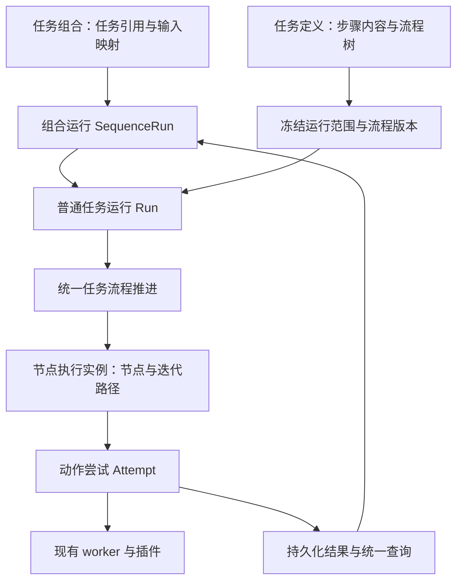

# 任务步骤控制流与编辑界面设计

## 2026-10-22 代码复审与重设计（待审核）

本节是本需求当前的设计提案。下方“原设计基线”保留上一轮方案与语义约定；本节明确修订的执行、定义保存和交互方式，在审核后替代对应旧方案。当前实现仍以源码及模块文档为准。本轮完成代码审查、最小复现及重设计，尚未修改产品代码。

### 结论与适配判断

任务组合负责串行调用可复用任务，任务负责组织动作步骤，这个分层符合 TaskWeave 的任务、运行、资源会话与结果边界。现有 `SequenceRun → Run → Attempt`、命令回执、租约、UNKNOWN 人工核对和 worker 可以保留。核心纯流程状态机、逐轮执行身份和结果持久化也是可保留的成果。

当前整合不完整：流程树已经成为新的顺序来源，但执行、步骤保存、复制、包校验和编辑器仍有依赖旧 `position` 的路径；运行范围和结果读取也分别判断是否使用控制流。这些差异已经造成可复现的错误，因此不宜继续以当前实现为基础叠加编排能力。

### 本轮已确认的问题

| 编号 | 优先级 | 可复现场景与实际影响 | 源码依据 |
| --- | --- | --- | --- |
| R1 | P1 | 两个动作按创建顺序 A、B 保存；流程树移动为 B、A 后，真实 worker 仍成功执行 A、B。随后仅编辑 A 的名称，流程树又被重建为 A、B。 | [执行分流](../../../src/taskweave/infrastructure/run_coordinator.py) 409–414 行；[步骤同步](../../../src/taskweave/infrastructure/repositories/steps.py) 85–90 行 |
| R2 | P1 | 控制流程中 B 在 A 前面，A 可合法引用 B；再让 B 引用 A，步骤保存仍成功，下一次 `task.flow.describe` 抛 `FLOW_REFERENCE_INVALID`。编辑器加载依赖该查询，因此普通保存可以让任务无法正常进入流程编辑。 | [保存绑定](../../../src/taskweave/infrastructure/repositories/steps.py) 53–55 行与 117 行；[编辑器读取](../../../src/taskweave/desktop/components/step_editor.py) 293 行 |
| R3 | P2 | 步骤创建顺序为 A、B，合法流程顺序为 B、A，且 A 引用 B。任务复制出现 `KeyError`；导出自身任务包后重新校验，得到 `TASK_PACKAGE_INVALID`。两处仍假定列表顺序等于依赖顺序。 | [复制](../../../src/taskweave/infrastructure/repositories/tasks.py) 108–116 行；[任务包校验](../../../src/taskweave/application/task_transfer.py) 99–117 行 |
| R4 | P2 | 三轮列表遍历配置动作间隔 1 秒，真实相邻间隔为约 1.032 秒、0.005 秒。实例内的尝试次数不能表示整次运行的执行先后，但上一动作查询按 `attempt_no` 排序。 | [上一成功动作查询](../../../src/taskweave/infrastructure/repositories/runs.py) 105–110 行；[间隔计算](../../../src/taskweave/infrastructure/flow_runner.py) 154–161 行 |
| R5 | P2 | 含控制节点的任务进行单步调试，执行成功且 attempt 有输出，但 `run.output` 报 `RESULT_NOT_FOUND`。单步执行没有流程实例，结果查询却按整任务控制流聚合。 | [结果查询](../../../src/taskweave/application/runs.py) 87–95 行；[执行范围判断](../../../src/taskweave/infrastructure/run_coordinator.py) 409–410 行 |
| R6 | P2 | 空列表遍历的命名 JSON 输出直接查询为合法的 `[]`，映射到下一个任务却报 `SEQUENCE_OUTPUT_NOT_JSON`，组合阻塞且下游运行未创建。组合读取要求至少一条成功 attempt，与空聚合语义冲突。 | [组合读取](../../../src/taskweave/application/sequence_driver.py) 80–94 行 |

R1–R3 在当前工作区的临时任务库复现，R1 使用真实 worker；对应代码与 `f2cb961` 一致。R4–R6 在 `git archive f2cb961` 的临时源码副本、临时任务库和真实 worker 中复现，独立于当前 AI 接入改动。首次从标准输入启动 R1 复现时，Python 子进程无法载入 `<stdin>`；改用临时脚本文件后，运行成功并确认错序。

另有两处直接接线缺口，应在交互重做中一并覆盖：输入来源仍按 `position` 筛选前序步骤（`step_editor.py` 546–550 行），无法选择流程移动后的合法来源；流程操作先保存动作，再使用动作保存前的任务哈希（317–320 行），有动作草稿时会与自身保存发生版本冲突。这两处本轮依据代码确认，未进行真实浏览器复现。

### 方案比较

| 方案 | 影响 | 判断 |
| --- | --- | --- |
| 逐个修补现有分流 | 改动起步较小，但执行、保存、查询和 UI 继续自行解释顺序与作用域，后续边界仍易分歧 | 只适用于紧急修复 |
| 保留两层业务对象，统一任务内定义与执行语义 | 复用组合及 worker，消除新任务的双重顺序来源；迁移范围可按单任务边界控制 | 推荐 |
| 所有任务、步骤与组合改成通用工作流节点 | 需重新设计嵌套运行、资源所有权、包格式和恢复协议，现有用户行为及历史受影响更大 | 当前需求没有足够依据支持此范围 |

### 推荐模型

1. **任务组合保持任务调用边界。** 组合节点引用任务、环境和输入映射；同一任务可出现多次，每个节点对应独立普通 Run。组合负责当前子运行、停止意图和后续节点推进；任务负责步骤执行及其资源。继续复用现有补参、重试、人工核对与归属保护。
2. **任务内部只有一个执行顺序来源。** 流程树负责顺序及作用域，Step 保存代码和输入输出契约。`position` 在新定义中仅作派生的展示/兼容信息，不能再决定执行或引用合法性，也不能重建已保存流程。顺序任务就是只包含动作的根序列。
3. **动作出现与步骤定义分开。** 保留每个动作步骤在树中一个位置的现行规则；循环产生不同执行实例。实例由运行、节点和完整迭代路径确定，重试次数只在该实例内计数；同一个任务的重复调用由组合节点身份区分。
4. **显式保存运行范围。** 正式执行、流程调试和单步调试均记录任务版本与实际执行范围。单步调试使用一个动作及用户样本输入；流程调试使用相应任务流程。调度、结果查询、补参、进度、NEXT/UNTIL 使用同一范围描述。运行模式和是否包含控制块分别表达，读取者无需再次猜测执行路径。

### 定义保存、校验与复制

在 core 建立一个共享的流程分析入口，输入完整步骤集合和流程树，输出结构诊断、各节点可见来源、循环归属及稳定节点索引。现有归一化和条件校验可继续复用。保存、确认、导入、复制及 UI 候选来源都消费这一份分析结果。

应用层提供任务定义变更入口，将步骤内容/绑定与节点移动作为一次带版本检查的修改。仓储在事务中验证最终结构和引用，成功后一起写入；无效引用不先写入再等待下一次读取报错。代码或条件内容未完成的草稿可保留诊断，读取和编辑草稿必须可用；确认和执行要求完整通过校验。跨节点调整在编辑草稿中完成后一次提交，避免用户必须依次保存若干互相矛盾的中间状态。

复制和导入先分配全部新身份，再重映射完整步骤、控制节点及绑定，最后整体验证并落库；不要求引用目标先出现在步骤数组中。旧包通过显式适配转成线性定义，新包按流程顺序及作用域校验。导出、复制和重新导入应保持同一执行语义。

### 执行、事实来源与数据映射

- 所有新建任务运行通过同一流程推进入口；现有 `core/flow_machine.py` 提供纯决策，Coordinator 保持命令、租约和资源协调，动作执行继续使用现有 worker。流程推进通过明确的查询、写入与动作执行接口协作，收窄对整个 Coordinator 内部状态的依赖。
- Attempt 是动作执行、外部副作用与结果的事实来源；流程实例记录位置与控制决策，游标记录下一次推进位置。成功 attempt 已保存而游标未更新时只补推进；UNKNOWN 必须先人工核对。实例投影与 attempt 不一致时按这些事实恢复，不根据重复保存的状态重新执行动作。
- 在游标或运行记录中明确记录“上一个成功动作实例/attempt”，步骤间隔从该动作的完成时间计算。实例内 `attempt_no` 仅用于重试序号，不能用于跨实例排序。
- 使用一个结果读取入口处理单次输出、同轮输出、循环聚合、分支公共输出和逐轮投影。任务内绑定、运行详情、调试和组合映射共享它；组合层保留“只能引用已成功前序子运行”的检查。
- 空列表得到 `[]`；每轮输出按原迭代顺序组成列表；嵌套保持层级；分支跳过位置保留状态并按现行约定投影为 `null`。命名 JSON 输出对实际执行的结果验证类型；没有执行实例的合法空聚合不要求虚构成功尝试。已有步骤输出映射和 JSON Pointer 继续兼容。
- 条件/遍历上限保存在各控制节点，沿用已确认的上限和失败处理语义。失败、补参、暂停、取消与 UNKNOWN 均停止向后推进，继续或重试定位到明确实例。
- 定义及环境变更继续遵守现有指纹阻塞规则。此次统一内核不附带“任意历史快照可直接重执行”的能力。

任务命名公共输出可以成为后续降低组合对内部步骤依赖的扩展。目前先保留已确认的步骤输出映射契约；新增任务公共输出及任务调用节点的分支/循环，需要单独确定产品范围。

### 编辑与运行界面

编辑器由一个任务级草稿管理步骤和流程。移动时可选择插入位置；可以同时调整条件、步骤位置和绑定，再以一个版本保存。候选输入来源按当前节点作用域计算，显示任务、步骤、循环和输出的名称；节点 ID 只用于内部身份及必要诊断。流程确认、步骤确认和调试证据保持各自含义。

组合编辑保持“选择任务 → 排顺序 → 连接输出与输入 → 一次启动”的主流程。运行详情展示组合节点、任务内部路径和当前轮次；单步调试展示本次样本结果，任务运行展示实际路径与聚合结果。原有 AI 编写、采集、代码、插件、输入、调试和管理操作继续可用。

### 迁移与实施边界

审核后按“定义与引用分析 → 统一任务执行/结果 → 编辑接线 → 组合映射验收”推进。先把 R1–R6 变成行为回归用例，再迁移对应调用链；细化实施任务继续维护在已有实施计划中。

旧定义读取时归一化；新运行使用统一入口。旧运行及已有执行路径原样保留，通过保存的执行器版本/运行范围适配读取与继续，不能仅凭当前任务结构把正在执行的旧运行切换到新内核。旧任务包和操作入口作为适配边界保留，避免建立永久的两套新任务执行规则。

当前 AI 接入另有未提交工作。实施前复核其操作、任务导入、输出投影及审核回执接线，协调重叠文件；本轮只更新本需求原有设计和计划状态，保护其他修改。

### 验收与本轮验证范围

实现验收应逐项观察：

1. 流程显示、保存后读取、真实执行、复制及包往返均按 B→A；编辑步骤内容不改变流程。
2. 无效前向/跨分支/跨循环引用有明确诊断；保存失败保留原定义；可编辑草稿能够重新打开。
3. 同一流程分析给 UI、确认、导入及执行提供一致的可用来源；带动作草稿的流程移动不会与自身保存发生版本冲突。
4. 每轮步骤间隔均遵守配置，包括前轮重试、暂停及恢复后的情况。
5. 单步调试、流程调试、正式任务执行和组合子运行都能按正确范围读取结果；空循环命名 JSON 输出可传入后续任务。
6. 真正重启及动作/游标提交边界验证不重复成功动作；UNKNOWN、补参和指定轮次重试保持原事实；旧线性中间重跑按已有策略兼容。

本轮已执行上述最小复现实验；独立审查在 `f2cb961` 下运行 `tests.test_flow_recovery` 和 `FlowExecutionTests.test_retry_one_failed_iteration_preserves_previous_success`，共 2 项通过。该恢复用例只证明同进程中成功 attempt 落库后游标提交失败的续跑行为，不能替代真实重启和 UNKNOWN 全边界验证。本轮未运行全量测试、真实浏览器验收或外部平台验收。

## 原设计基线

## 目标和边界

任务作者可以在原有动作步骤之间配置结果分支、条件循环和列表遍历。一次运行按保存的流程自动选择路径，循环中的每次动作都有独立结果；后续任务步骤和任务组合可以读取完成后的聚合输出。步骤页面展示流程结构，同时保留现有编写、绑定、调试、AI 辅助、采集、确认和管理操作。

本次支持嵌套控制块，最大深度为 8。控制块只负责编排，固定执行不调用模型。首版不提供任意跳转、并行、失败后自动换路径或用户自写控制器脚本。动作步骤仍使用 `python-async-v1` 和现有插件 SDK。

## 当前实现依据

`tasks.graph_json` 已存在，但 `StepRepository._sync_task_graph` 在保存、移动和删除步骤时总把它重建为线性动作链。`Coordinator._drive` 按 `position` 遍历，并以 `(run_id, step_id)` 的最新成功尝试跳过步骤。尝试路径固定为 `/main/<step_id>`，结果读取也按步骤取最新尝试。循环若沿用这些判定，会复用上一轮结果并可能漏执行动作。运行的暂停、显式重试、UNKNOWN 人工核对和任务组合推进都依赖这些历史事实。

步骤编辑页面目前左侧是平面步骤目录，中间依次展示名称、描述、插件、动作表单、绑定、上下文、时间及代码，右侧调试区按需打开。流程编辑要保留现有入口及未保存草稿保护。

## 流程定义

`graph_json` 成为任务的权威流程定义，使用带版本号的结构化块。根块为 `sequence`；子块包括：

- `action`：引用一个既有 `step_id`，执行一次动作。
- `if`：计算条件，进入成立或不成立分支，分支结束后在父序列汇合。
- `foreach`：从绑定读取 JSON 列表，冻结本次列表后逐项运行循环体。
- `loop`：按条件重复循环体，支持进入前判断和执行后判断；循环状态有初始值及每轮更新映射。

各控制块有稳定 `node_id`，每个动作步骤在流程树中恰有一个位置。新增动作按所选序列插入，复制动作产生新 `step_id`。移动只能将完整块移入合法的序列位置；删除块需处理其包含动作及引用，不能留下悬空引用。旧线性图按原顺序解释成根序列；编辑控制流时转换为新版本。保存动作正文不重建流程树。定义指纹包括步骤内容和流程结构；已有运行继续遵守定义变更阻塞规则。

控制流定义有独立的草稿/已确认状态和被确认的定义指纹。每次变更控制结构、条件、循环参数或输出映射均回到草稿；静态校验通过后由作者显式确认当前版本，正式运行要求步骤和整个流程均已确认。线性旧任务按原步骤确认规则运行，不增加新的确认动作。控制结构变化不额外清除动作验证证据；动作证据仍遵守现有失效规则。

条件使用受限的 JSON 值比较：相等、不相等、大小比较、存在、为空、包含，以及全部、任一、取反。操作数为常量或 `task`、`environment`、步骤输出、循环项、索引、循环状态的绑定；定位使用 JSON Pointer。循环变量的来源包含所属循环 `node_id`，嵌套时不隐式选择某一层。`exists` 在路径不存在时返回 false；其他运算遇到缺失报错。`empty` 仅检查字符串、数组和对象长度是否为零；检查 `null` 使用显式相等。大小比较只接受同类数字或字符串，布尔不视为数字。保存时校验结构、引用和作用域；实际输出仍在运行时校验。

## 循环与作用域

`foreach` 在进入时读取并持久化完整列表，空列表跳过循环体。每轮提供 `item`、从 0 开始的 `index` 和当前轮路径；已执行的本轮输出可用于同轮后续步骤。外层已完成输出可被内层读取。`loop` 使用显式循环状态，初始值从外层作用域读取，更新映射可读取旧状态和本轮结果；所有映射有效后一次提交。进入前判断的 `while` 模式条件为真时执行，为假时退出。执行后判断的 `until` 模式至少执行一轮，条件为真时退出，为假时继续。每轮先完成动作，再原子更新状态，最后决定是否执行下一轮。

条件循环默认最多 100 轮，作者可在对应控制块配置 1–10,000；列表遍历默认最多 1,000 项，作者可配置 1–10,000。列表超限在首项执行前失败。条件循环达到上限时先判断退出条件：已满足则正常结束，仍需继续则报 `LOOP_LIMIT_EXCEEDED`，运行标记失败并明确显示为需人工处理，保留已完成各轮结果；修正定义后新建运行。每次运行最多创建 100,000 次动作尝试，重试计入且重启不清零。上限及当前用量在编辑和运行界面可见。

循环体内引用动作输出按本轮执行实例读取。循环外引用体内动作时，按迭代顺序得到列表；任务内部跨循环绑定使用显式 `item_pointer` 对每轮结果投影后再聚合，原 `pointer` 仍作用于完整返回值。投影指定循环 `node_id`，不能把业务数组误识别为循环层级。空循环得到 `[]`，嵌套循环保留嵌套结构。某轮分支未执行的动作在聚合中占 `null`，同时保留“跳过”事实以区别真实 `null`；已执行但缺少所需结果仍报错。完整聚合只在循环结束后供下游使用。分支外消费某分支的结果需配置分支公共输出，或显式处理缺失。非 JSON 文件结果保留原有引用与查看方式，不隐式转换路径。

`run.output(run_id, step_id, output)` 返回该步骤完整有效的聚合结果；逐轮查看须显式指定执行实例。任务组合既有 JSON Pointer 继续作用于这个完整返回值；需要逐项投影时使用新增的可选投影字段，且显式指定循环层级。

## 执行实例、恢复与重跑

动作执行实例由 `run_id + node_id + 完整迭代路径` 唯一标识，重试是同一实例的新尝试。持久化流程定义快照、当前游标、控制块实例、已选分支、冻结的遍历列表、循环状态、尝试及结果关联。控制决策和游标推进只根据已持久化的成功输出计算，并原子写入；启动动作前记录实例和意图。恢复先核对已有尝试及结果回执：成功实例只推进一次，未知副作用进入人工核对，绝不自动重发。

动作失败立即停止，不自动进入下轮或另一分支。UNKNOWN 阻塞后续执行；人工核对只作用于对应实例。缺输入暂停时记住该实例和输入请求身份。暂停、取消在条件和迭代边界生效。失败重试只针对当前实例，已完成前轮保留。按结构识别只有 `sequence/action` 的线性任务，保留其中间重跑；包含控制块的任务已成功实例从头重做需新建整次运行。确定性的控制配置错误归属控制块实例并终止当前运行，修正定义后新建运行，不提供无法恢复的“继续”。结果查询及任务组合映射使用有效实例；循环完成后的输出可被后续任务读取。

## 步骤界面

左侧改为可折叠流程树，显示动作、分支及循环范围；中间编辑当前节点，右侧调试区继续按需打开。动作编辑以名称、描述和主要设置为首屏；代码、输入与结果绑定、插件与时间、上下文/AI 辅助整理为清晰标签或展开区。控制节点以表单编辑条件、列表来源、循环状态和上限，无需手写流程 JSON。固定主操作为保存、调试、确认；添加、移动、复制、删除和批量确认等放在可发现的工具栏或“更多”菜单。

保留当前步骤的全部操作：AI 生成描述和内容、恢复 AI 结果、动作表单插入、Schema 与输入绑定、插件能力、超时与步骤间隔、上下文采集、单步及流程调试、手动及批量确认、上移下移、删除、保存冲突与离页草稿处理。界面整理前建立操作清单，实际浏览器逐项核对。新增循环作用域模拟输入供单步调试；模拟不推进正式运行游标，也不替代真实流程验证。修改条件、顺序、循环参数或映射使整体流程确认失效；动作正文未变可保留单步验证证据，正式启动仍须确认当前整体流程。流程保存使用任务级版本检查，防止与动作保存互相覆盖。

流程调试的“下一步”推进到并执行下一个实际动作实例，控制节点可以在此期间完成判断，不额外消耗动作步数。“运行到”指目标动作节点的下一次可达出现；若目标被分支跳过，则显示未命中。条件计算、列表读取、状态更新及达限错误定位到对应控制块实例，即使没有动作尝试也能显示失败位置。流程调试和执行页展示分支选择、当前轮/列表项、每轮尝试与聚合结果。原步骤位置在控制流中不再表示执行顺序，页面上的进度按实际访问路径呈现。

## 契约与兼容

新任务包使用显式新版格式，包含流程树及步骤稳定键；导入继续接受旧格式并生成线性根序列，导出不会丢失控制块。复制任务重映射动作键及流程引用。任务接口、操作路由和结果查询增加流程信息；旧调用仍能处理线性任务。SQLite 增量迁移保留已有任务、运行和结果，新增控制实例/游标持久化；不得修改真实业务数据作为测试。

## 验收和验证

- 两分支与汇合按结果只执行选中路径；条件类型错误和缺失输出明确报错。
- 条件循环覆盖零、一、多轮及达限；列表遍历覆盖空列表、重复值、逐轮输出、嵌套和跳过位置，聚合顺序正确。
- 同一动作各轮结果隔离；绑定、补参、失败重试和 UNKNOWN 核对定位到准确执行实例。
- 在决策记录、动作启动、结果写入和循环状态提交边界重启后，不重做已成功或副作用不明的动作。
- 旧线性任务运行、调试、中间重跑，旧任务包导入及任务组合输出映射保持可用。
- 实际浏览器可创建和编辑控制块、保存、执行、查看逐轮结果；现有步骤操作逐项仍可访问。

使用 `tests/module-map.json` 选择受影响的仓储、应用、界面和真实 worker 验证；运行工程检查与 `git diff --check`。全量测试依项目授权要求另行处理。
